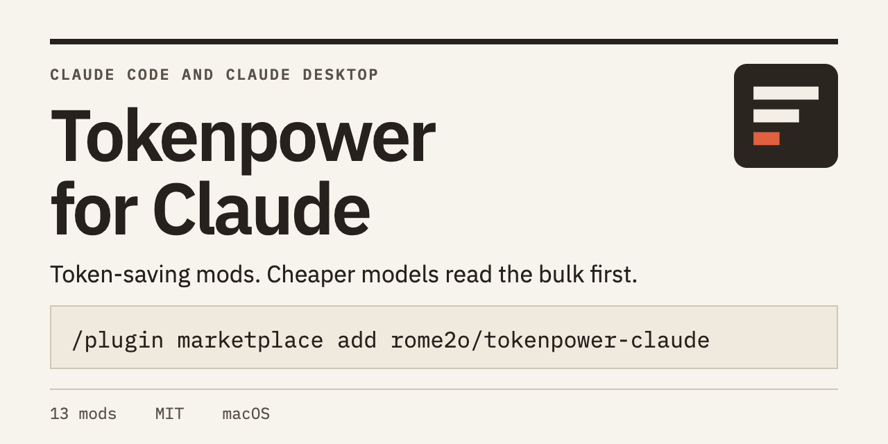
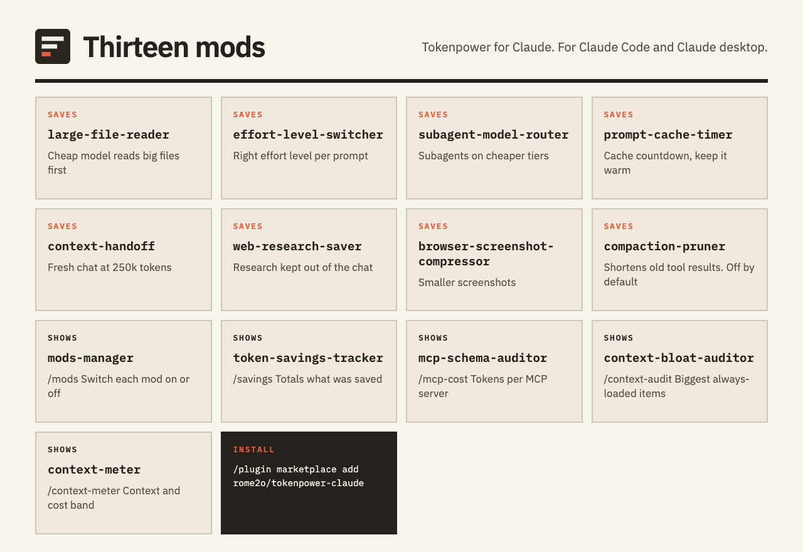

# Tokenpower for Claude: token-saving mods and plugin marketplace for Claude Code and Claude desktop

<p align="center"></p>

Tokenpower is a plugin marketplace for Claude Code and Claude desktop with thirteen mods that cut token usage and cost, and show where your tokens go. Cheaper models read big files, web pages and screenshots first, subagents move to lower tiers, and panes total your savings. Each mod switches on or off on its own.

Requires Claude 2.1.287 or newer (terminal), or 2.1.286 or newer (desktop app). macOS is the tested platform.

## Quickstart

In Claude:

```
/plugin marketplace add rome2o/tokenpower-claude
/plugin install large-file-reader@tokenpower-claude
/plugin install token-savings-tracker@tokenpower-claude
/plugin install mods-manager@tokenpower-claude
/reload-plugins
```

Type `/mods` to see every mod and switch each on or off. Type `/savings` for the totals. The other mods install the same way, for example `/plugin install web-research-saver@tokenpower-claude`.

## The thirteen mods

<p align="center"></p>

| Mod | What it does |
|---|---|
| large-file-reader | Haiku reads big files and connector results first. Claude gets short notes and a path to the full content. |
| effort-level-switcher | Picks the effort level each prompt needs and offers to switch to it, or sets it in auto mode. |
| subagent-model-router | Moves a subagent task to a cheaper model when Haiku is confident it is simple enough. |
| prompt-cache-timer | Counts down until the prompt cache goes cold, and can ping it to keep it warm. |
| context-handoff | At 250k tokens, writes a handoff of the chat and starts a fresh chat with it. |
| web-research-saver | Keeps web research out of the main chat. A cheap worker reads pages and returns a short brief with sources. |
| browser-screenshot-compressor | Shrinks browser screenshots, or has Haiku describe them in words. |
| mods-manager | The `/mods` pane. Finds every mod on the machine and switches each on or off. |
| token-savings-tracker | The `/savings` pane. Totals the tokens the other mods saved. |
| mcp-schema-auditor | The `/mcp-cost` pane. Ranks your MCP servers by the tokens their tool definitions add to every request, and suggests which to disable with `/mcp`. Estimates only. Never changes your config. |
| context-bloat-auditor | The `/context-audit` pane. Lists the always-loaded items that cost the most tokens and flags big or duplicated ones. Read-only. |
| context-meter | The `/context-meter` band above the prompt. Shows context by category, distance to compaction, session cost as the engine reports it, and today's tokens saved. |
| compaction-pruner | Off by default. At compaction, shortens old large tool results and keeps the originals in a folder you can open. Dry run first. Deletes nothing. |

## Status of the four newest mods

mcp-schema-auditor, context-bloat-auditor, context-meter and compaction-pruner (all 0.1.0) are type-checked and unit-checked but not yet run in a live Claude session. They make no savings claims, and the pruner does not write to the savings ledger.

## How it saves tokens

A cheap model reads large inputs and hands Claude short notes plus a path to the full result. Subagent tasks and prompts go to the cheapest tier that can do them. The cache timer and context handoff avoid paying to rebuild a cold or oversized chat.

## Optional tools

- `brew install poppler` lets the large file reader read PDFs.
- The Firecrawl command-line tool (npm) lets the web research saver scrape pages.
- The screenshot compressor uses `sips`, which ships with macOS.

## What they touch

The mods keep shared state under `~/.claude/mods`, `~/.claude/mods-logs` and `~/.claude/handoffs`. Turning a mod off in `/mods` leaves the others running. The web research saver fetches public URLs found in search results and skips local and private addresses. It treats fetched text as untrusted data. The large file reader only opens saved outputs under `~/.claude/projects/`. The context handoff reads the chat transcript to write its summary.

The four newest mods make no network calls. compaction-pruner is off by default, deletes nothing, and masks API keys and tokens in the copies it keeps. context-bloat-auditor never reads your file contents.

See `SECURITY.md`.

## Contributing and license

Built and maintained by Kazim Ali. Issues and pull requests are welcome, see `CONTRIBUTING.md`.

Need help cutting AI costs in your own stack? Talk to Kazim at [kazim.com.au](https://kazim.com.au).

MIT, see `LICENSE`. The subagent-model-router plugin is derived from an MIT-licensed model router and keeps that notice in `plugins/subagent-model-router/LICENSE`.
